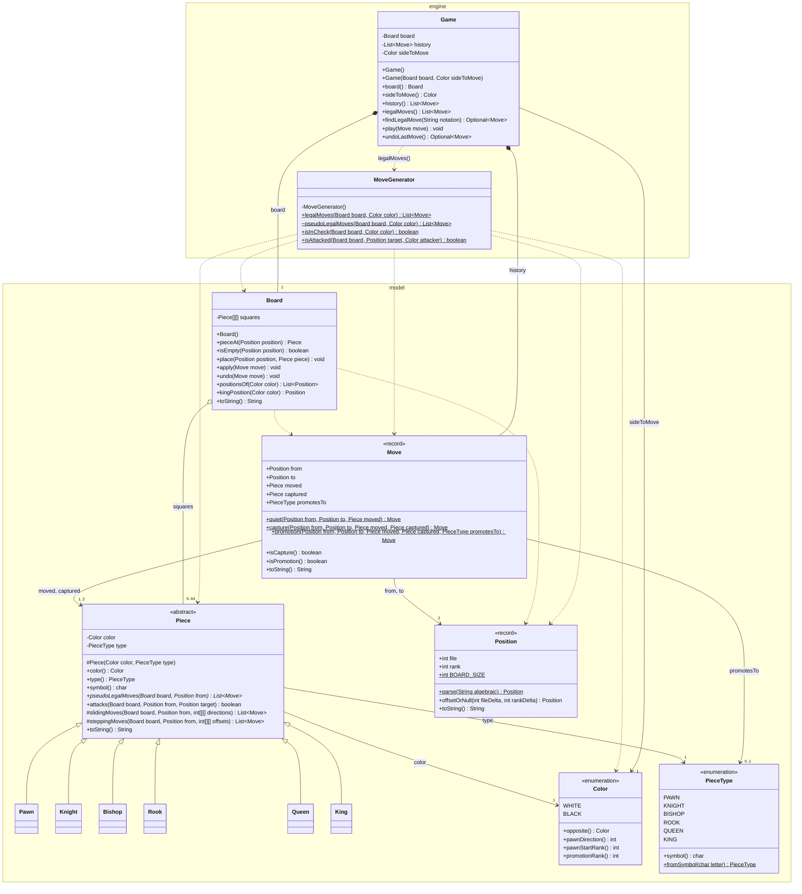
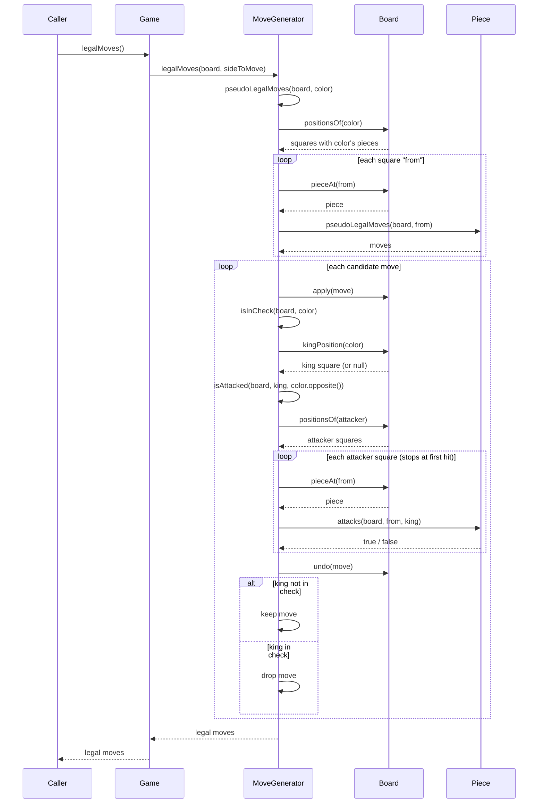

# Design

Diagrams of the engine as of M5.

## Class diagram (engine + model)

The six piece subclasses are drawn without methods, they all just override
`pseudoLegalMoves` (Pawn also overrides `attacks`).

## Sequence diagram: `game.legalMoves()`

